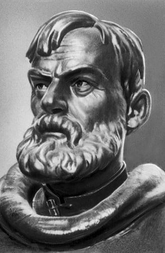

Имя Семёна Дежнёва, отважного русского морехода, гремит по всему свету, напоминая о временах великих географических свершений.

Семён Иванович Дежнёв — выдающийся русский землепроходец, чьи достижения в освоении Севера и Дальнего Востока вызывают восхищение. Несмотря на полное отсутствие навигационных приборов и инфраструктуры, он сумел совершить одно из главных географических открытий своего века.

Вопрос о месте рождения исследователя (1605 г.) остается дискуссионным: по одной версии, он происходил из Великого Устюга, по другой — с Пинеги. С юных лет Дежнёв участвовал в походах: сначала с отцом, а с 17 лет — самостоятельно, совершив первое плавание к Заполярью и устью Оби. В 1630-х годах он начал казачью службу в Сибири, сменив гарнизоны Тобольска и Енисейска. В ходе экспедиции под началом Михаила Стадухина на реки Алазею и Колыму Дежнёв проявил инициативу и остался исследовать регион, став одним из первооткрывателей Колымы и основателем ряда поселений. Современники отмечали его исключительную честность и организаторский талант.

Семён Дежнёв вошел в историю как выдающийся исследователь Сибири, Колымы и Чукотки. Именно он первым достиг крайней восточной точки Чукотского полуострова, которая сегодня носит его имя. Его экспедиции к реке Колыме заложили основу для развития судоходства и расширения внешнеторговых отношений. В период работы в Анадыре Дежнёв проявил себя как талантливый управленец: он собирал ясак с коренных народов, хотя не обходилось и без вооружённых стычек, и наладил добычу моржовой кости, найдя в 1652 году моржовое лежбище. Его донесения пролежали в якутском архиве до 1736 года, когда их обнаружил историк Г. Ф. Миллер, — лишь тогда открытие Дежнёва стало известно учёным и попало на карты. В память о заслугах Дежнёва его именем названы географические объекты в Баренцевом и море Лаптевых, а также бухта на Камчатке.

В 1647 году Семён Дежнёв совместно с предпринимателем Федотом Поповым предпринял попытку экспедиции к реке Погыче. Поиск новых территорий в то время был продиктован экономическими интересами: купцы и государственные служащие стремились обнаружить залежи полезных ископаемых и новые промысловые угодья.

После провала первой экспедиции, в 1648 году, была организована масштабная кампания с участием около 90 человек и семи поморских кочей. Это событие стало ключевым в карьере Дежнёва. В ходе плавания он обследовал Чукотский полуостров и достиг островов Диомида, где зафиксировал присутствие коренного населения (вероятно, эскимосов, которых он принял за чукчей). Кульминацией похода стал выход в пролив, разделяющий Азию и Америку, что стало важнейшим географическим открытием того времени.

<figure style="margin: 24px 0">

<figcaption style="font-size: 14px; color: #666">Коч — поморское судно, на каких ходил Дежнёв. Копия в Красноярском краеведческом музее</figcaption>
</figure>

После того как Дежнёв успешно прошёл Берингов пролив, удача отвернулась от него: море встретило путешественника мощным штормом. Выброшенный на берег Анадыря, исследователь не отступил и решил обосноваться на новом месте. В общей сложности он посвятил десять лет освоению этого региона, активно работая над установлением связей с местным населением.

Вернувшись в Якутск в 1662 году, Семён Дежнёв оставил заметный след в истории освоения края. На посту в Анадыре он не только наладил взаимодействие с местным населением, но и обеспечил регулярные поставки ценной моржовой кости в российскую столицу. В 1664 году Дежнёв приехал в Москву, где ему выплатили жалованье за 19 лет и пожаловали чин казачьего атамана. В 1670 году его снова отправили в Москву — сопровождать соболиную казну. Дежнёв прошел путь от простого казака до крупного управленца, чьи организаторские способности и географические открытия навсегда вошли в историю.

Признание пришло к Семёну Дежнёву лишь спустя годы после его кончины в 1673 году. Сегодня имя этого выдающегося исследователя северных рубежей России известно всему миру. Память о нём увековечена в кинолентах, монументах и мемориальных досках. В честь мореплавателя называют улицы и географические объекты по всей планете: от острова в море Лаптевых до залива в Баренцевом море и бухты на Камчатке. Мировое сообщество чтит его как первооткрывателя земель Сибири, Колымы и Чукотки.

**Любопытный факт:** Именно Дежнёв первым достиг крайней восточной точки Чукотского полуострова, которая сегодня носит его имя. В XVII веке этот мыс был известен мореходам как Большой Каменный Нос.

<figure style="margin: 24px 0">

<figcaption style="font-size: 14px; color: #666">Мыс Дежнёва на Чукотке: маяк-памятник Семёну Дежнёву</figcaption>
</figure>

Россия бережно хранит память о Семене Ивановиче Дежневе. Его монументы стоят в ключевых точках его биографии: на далеком мысе Дежнева, в Якутске и Великом Устюге. В Москве память исследователя отмечена бюстом, а в небольшой деревне Сояла, что в Архангельской области, установлена мемориальная доска.

<figure style="margin: 24px 0">

<figcaption style="font-size: 14px; color: #666">Памятник Семёну Дежнёву и его жене Абакаяде в Якутске</figcaption>
</figure>

---

Автор статьи: [Анастасия Сарычева](/authors/anastasia-sarycheva/)
